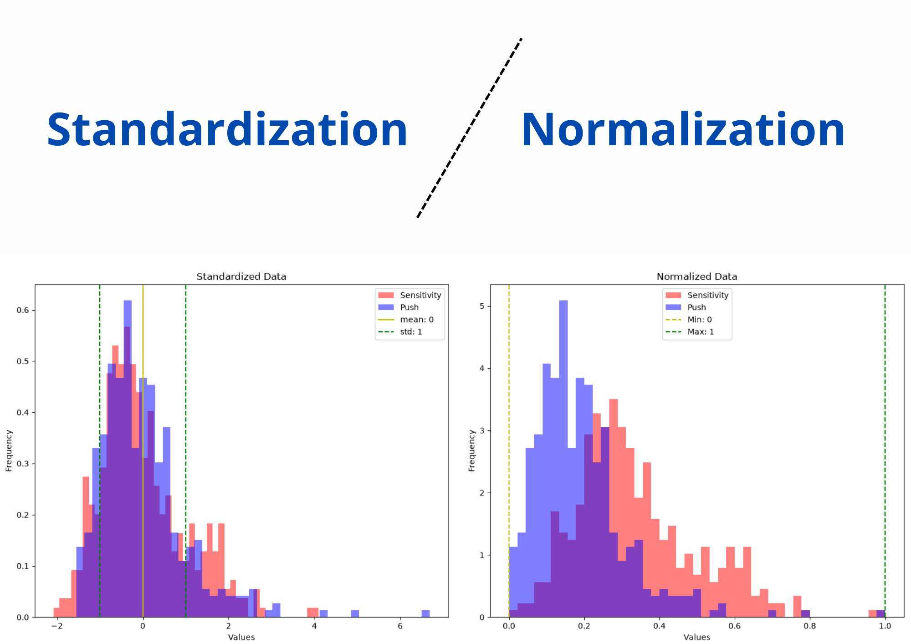
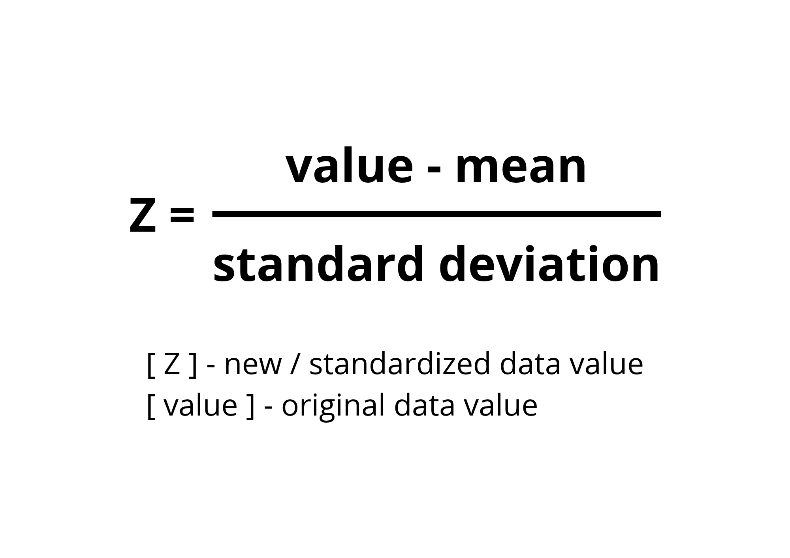
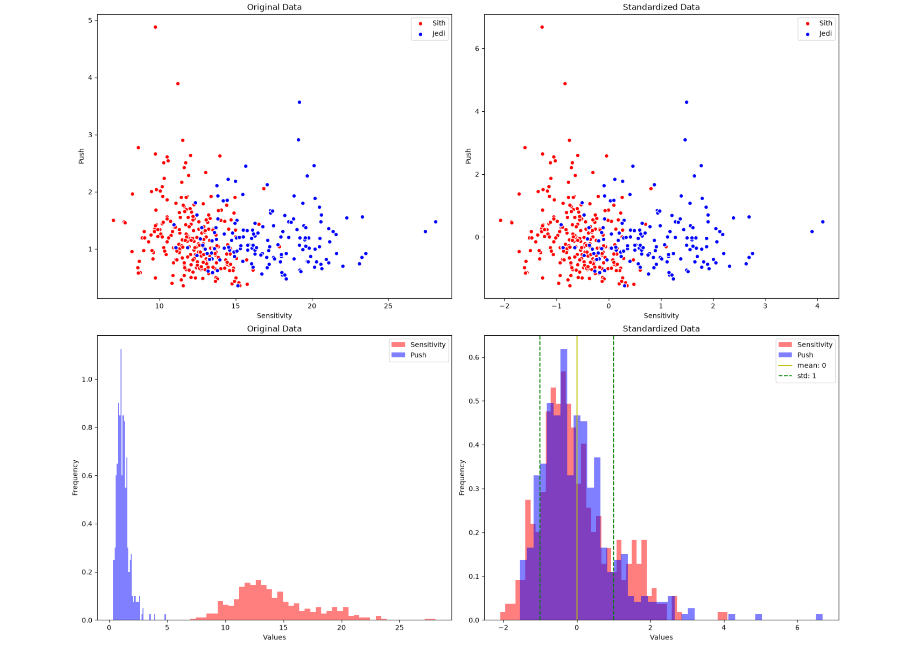
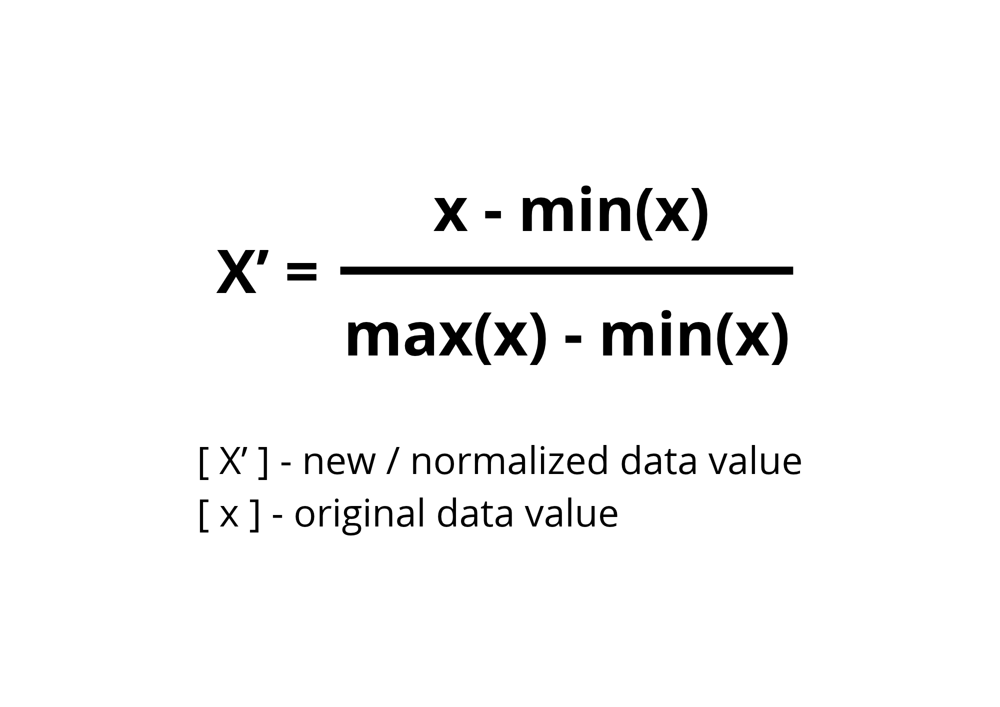
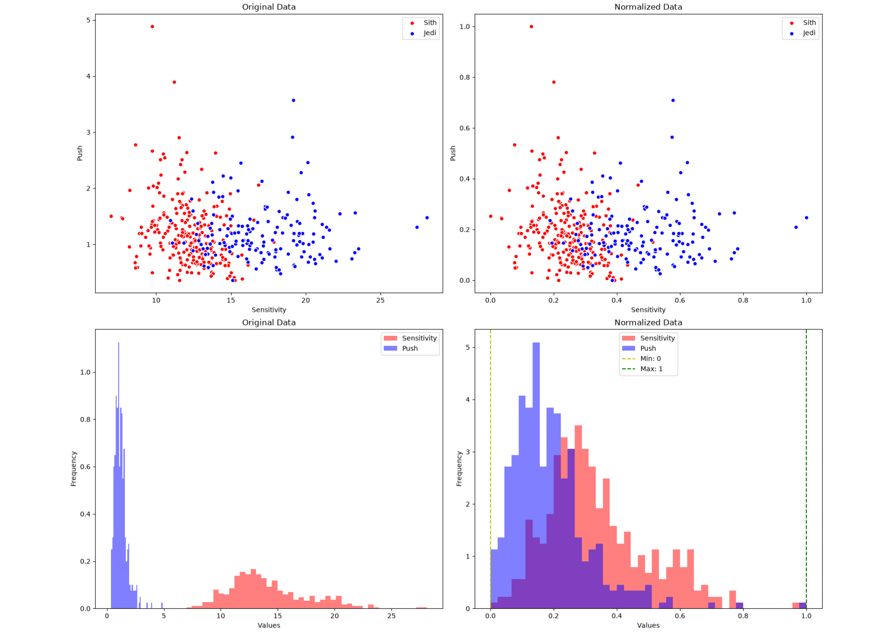

# Standardization / Normalization

2 methods – 1 goal: An essential step in data preprocessing for machine learning and data analysis.

<div align="center">
  
</div>

---

## 📖 Table of Contents

* [Overview](#-overview)
* [Standardization](#-standardization-1️⃣--0️⃣--1️⃣)
* [Normalization](#-normalization-0️⃣--1️⃣)
* [Differences](#️-differences)
* [Prerequisites](#-prerequisites)
* [Execution](#-execution)
* [Documentation](#-documentation)
* [Cleanup](#-cleanup)

---

## 📊 Overview

**Standardization** and **Normalization** are two preprocessing techniques that bring variables to a common scale to ensure that they contribute more equally and to improve the performance of machine learning models.

In this project, we will explore three key questions for each method:

1. What is it?
2. Why use it?
3. When should it be used?

### ✨ Key Features

* Understand the purpose of **Standardization**.
* Understand the purpose of **Normalization**.
* Understand the differences between the two methods.

---

## 📐 Standardization (➖1️⃣ ➤ 0️⃣ ➤ 1️⃣)

<div align="center">
  
</div>

### 1. What is it?

- **Standardization** transforms each numerical column so that it has a *mean of 0 and a standard deviation of 1*.
- This brings all variables to *a common scale without changing their relative positions* within the original data distribution.

<div align="center">
  
</div>

### 2. Why use it?

- Prevents variables with larger numerical values from dominating the others.
- Allows variables to contribute more equally to the model's learning process.
- Can improve convergence and the performance of certain algorithms.

### 3. When should it be used?

Standardization is particularly useful for algorithms that are sensitive to feature scales, including:

- [K-Means Clustering](https://github.com/xtluu/K-Means_Clustering)
- Linear and Logistic Regression with regularization.
- Support Vector Machines (SVM).
- Principal Component Analysis (PCA).
- K-Nearest Neighbors (KNN).

---

## 📏 Normalization (0️⃣ ➤ 1️⃣)

<div align="center">
  
</div>

### 1. What is it?

- Like **Standardization**, **Normalization** brings all variables to a common scale to make them easier to compare. However, it includes several scaling techniques, each designed for specific needs, such as:
  - Maximum Absolute Scaling.
  - Min-Max Feature Scaling.
- In this project, we use the **Min-Max Feature Scaling** technique, which transforms feature values to fit *within a fixed range between 0 and 1*.

<div align="center">
  
</div>

### 2. Why use it?

- Scales variables to a common range, usually [0, 1].
- Prevents variables with a large range of values from dominating the others.
- Can improve the convergence of gradient-based algorithms.
- Makes distance calculations between observations easier.

### 3. When should it be used?

Min-Max Normalization is particularly useful for algorithms that are sensitive to feature scales, such as:

- K-Nearest Neighbors (KNN).
- Support Vector Machines (SVM).
- Neural Networks.

---

## ⚔️ Differences

| Criteria | Standardization | Normalization (Min-Max) |
| ---------------------------- | --------------------------------------------- | ------------------------------------------- |
| **Objective** | Center and scale the data | Scale the data to a fixed range |
| **Method** | Mean and standard deviation | Minimum and maximum |
| **Resulting Scale** | Mean = 0, standard deviation = 1 | Usually [0, 1] |
| **Reference Point** | Centers the data around 0 | The minimum value becomes 0 |
| **Sensitivity to Outliers** | Sensitive, but generally less than Min-Max | Highly sensitive |
| **Relevant Algorithms** | SVM, PCA, KNN, regularized regression | KNN, SVM, Neural Networks |

💡 **Key Takeaways**

- **Standardization**: centers the data *around 0* and scales it according to its standard deviation.
- **Normalization (Min-Max)**: transforms the data to fit *within a range between 0 and 1*.

---

## 🚩 Prerequisites

### 1. Setting Up the Environment and Installing Dependencies

```bash
# Generate the configuration files
make config

# Create and activate the virtual environment
python3 -m venv myenv
source myenv/bin/activate

# Install dependencies
make requirements
```

### 2. Configuring Environment Variables

⚠️ The project requires the following configuration files:

| File | Purpose |
| --------------- | ----------------------------------------------------------------------------------- |
| `.env` | Contains the environment variables used by the containers. |
| `database.init` | Contains the information required to connect to the database server. |

### 3. Building and Starting the PostgreSQL and pgAdmin Containers

```bash
make up
```

---

## 🚀 Execution

Once the virtual environment is activated and the dependencies are installed, run the program using:

```bash
python3 src/main.py
```

---

## 📚 Documentation

- [Built In – When and Why to Standardize Your Data](https://builtin.com/data-science/when-and-why-standardize-your-data)
- [GeeksforGeeks – How to Standardize Data in a Pandas DataFrame](https://www.geeksforgeeks.org/python/how-to-standardize-data-in-a-pandas-dataframe/)
- [GeeksforGeeks – Standard Deviation Formula](https://www.geeksforgeeks.org/maths/standard-deviation-formula/)
- [GeeksforGeeks – Data Normalization with Pandas](https://www.geeksforgeeks.org/python/data-normalization-with-pandas/)

---

## 🧹 Cleanup

### Deactivating the Virtual Environment

To deactivate the Python virtual environment `myenv`, run:

```bash
deactivate
```

### Removing the Containers and Virtual Environment

To remove the containers and the project's virtual environment, run:

```bash
make clean
```

---

<div align="center">

**Created by Tien LUU**

[⬆ Back to Top](#-table-of-contents)

</div>
