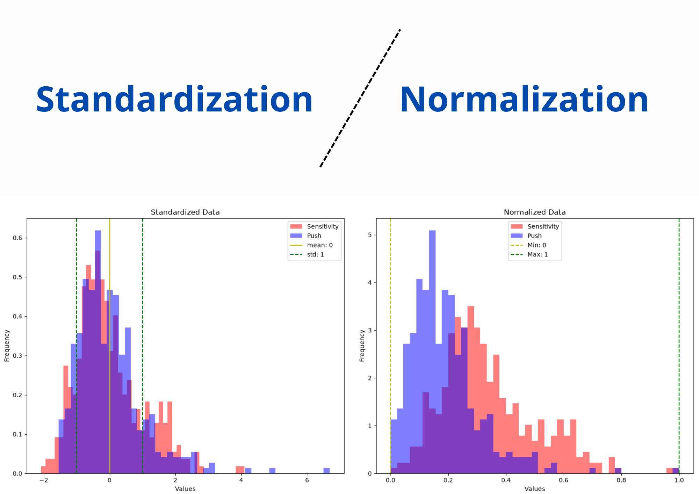
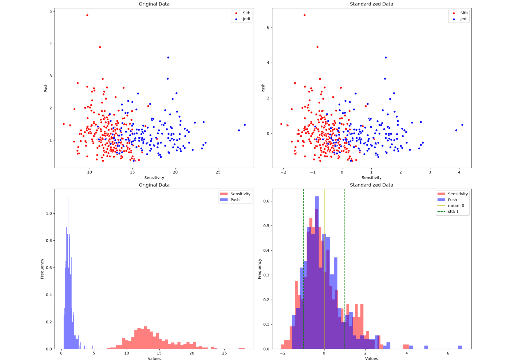
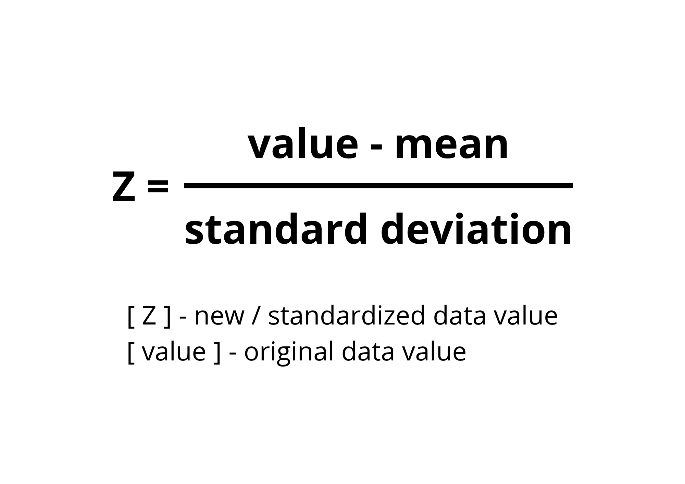
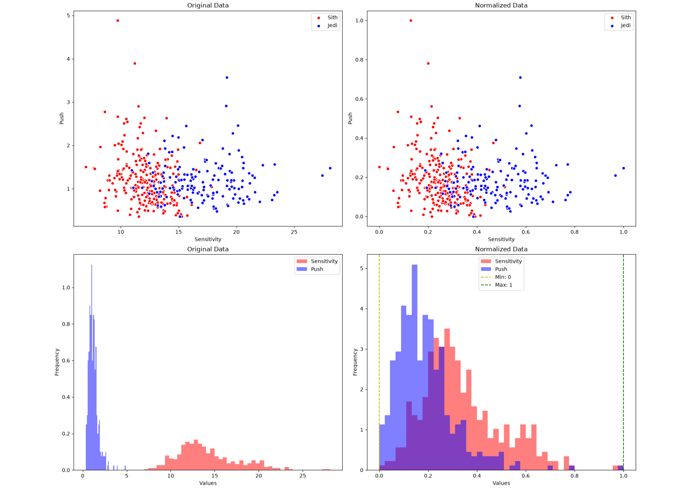
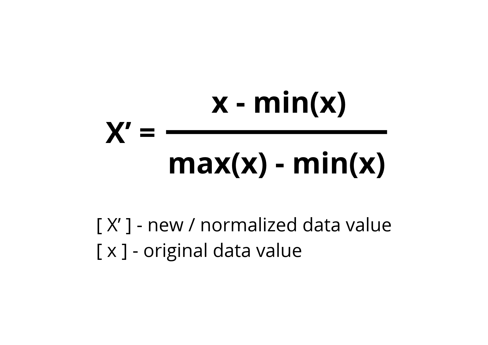

# Standardization / Normalization

2 méthodes - 1 objectif : L'étape essentielle lors de la préparation des données pour l’apprentissage automatique et l’analyse.

<div align="center">
   
</div>

---

## 📖 Table des matières

* [Présentation](#-présentation)
* [Standardisation](#-standardisation-1️⃣--0️⃣--1️⃣)
* [Normalisation](#-normalisation-0️⃣--1️⃣)
* [Les differences](#️-differences)
* [Prérequis](#-prérequis)
* [Exécution](#-exécution)
* [Documentation](#-documentation)
* [Nettoyage](#-nettoyage)

---

## 📊 Présentation

La **standardisation** et la **normalisation** sont deux méthodes de prétraitement qui mettent les variables sur une échelle commune afin d'assurer leur contribution équitable et d'améliorer les performances des modèles d’apprentissage automatique.

Dans ce projet, nous allons répondre ensemble à trois questions majeures pour chaque méthode :

1. Qu’est-ce que c’est ?
2. Pourquoi l’utiliser ?
3. Quand l’utiliser ?

### ✨ Points clés

* La fonction de la **standardisation**.
* La fonction de la **normalisation**.
* La différence entre les deux méthodes.

---

## 📐 Standardisation (➖1️⃣ ➤ 0️⃣ ➤ 1️⃣)

<div align="center">
   
</div>

### 1. Qu’est-ce que c’est ?

- La **Standardisation** transforme chaque colonne numérique de sorte qu’elle présente *une moyenne de 0 et un écart-type de 1*.
- Cela permet de ramener toutes les variables à *une échelle commune, sans modifier leur position relative* par rapport à l'origine des données.

<div align="center">
   
</div>

### 2. Pourquoi l’utiliser ?

- Évite qu'une variable ayant des valeurs numériques plus élevées domine les autres.
- Permet aux variables de contribuer de manière plus équilibrée à l'apprentissage du modèle.
- Peut améliorer la convergence et les performances de certains algorithmes.

### 3. Quand l’utiliser ?

La standardisation est particulièrement utile pour les algorithmes sensibles à l'échelle des variables, notamment:
- [K-Means Clustering](https://github.com/xtluu/K-Means_Clustering)
- Régression linéaire et logistique avec régularisation.
- Support Vector Machines (SVM).
- Principal Component Analysis (PCA).
- K-Nearest Neighbors (KNN).

---

## 📏 Normalisation (0️⃣ ➤ 1️⃣)

<div align="center">
   
</div>

**1. Qu’est-ce que c’est ?**

- Comme la **Standardisation**, la **Normalisation** permet de ramener toutes les variables à une échelle commune afin de faciliter leur comparaison. Cependant, elle regroupe différentes techniques de mise à l'échelle, chacune adaptée à des besoins spécifiques, telles que:
   - Maximum Absolute Scaling
   - Min-Max Feature Scaling
- Dans ce projet, nous avons utilisé la technique du **Min-Max Feature Scaling**, qui consiste à transformer les valeurs d'une caractéristique pour les ramener dans *un intervalle fixe compris entre 0 et 1*.

<div align="center">
   
</div>

### 2. Pourquoi l’utiliser ?

- Ramène les variables dans un intervalle commun, généralement [0, 1].
- Évite qu'une variable ayant une grande amplitude domine les autres.
- Peut améliorer la convergence des algorithmes fondés sur le gradient.
- Facilite les calculs de distance entre les observations.

### 3. Quand l’utiliser ?

La normalisation Min-Max est particulièrement utile pour les algorithmes sensibles à l'échelle des variables, tels que:
- K-Nearest Neighbors (KNN).
- Support Vector Machines (SVM).
- Réseaux de neurones (Neural Networks).

---

## ⚔️ Differences

| Critères                     | Standardisation                               | Normalisation (Min-Max)                     |
| ---------------------------- | --------------------------------------------- | ------------------------------------------- |
| **Objectif**                 | Centrer et réduire les données                | Ramener les données dans un intervalle fixe |
| **Méthode**                  | Moyenne et écart-type                         | Minimum et maximum                          |
| **Échelle obtenue**          | Moyenne = 0, écart-type = 1                   | Généralement [0, 1]                         |
| **Origine**                  | Centre les données autour de 0                | Le minimum devient 0                        |
| **Sensibilité aux outliers** | Sensible, mais généralement moins que Min-Max | Très sensible                               |
| **Algorithmes concernés**    | SVM, PCA, KNN, régressions régularisées       | KNN, SVM, réseaux de neurones               |

💡 À retenir
- **Standardisation**: centre les données *autour de 0* et les exprime en fonction de leur écart-type.
- **Normalisation (Min-Max)**: transforme les données pour les ramener dans un intervalle compris *entre 0 et 1*.

---

## 🚩 Prérequis

### 1. Installation l'environnement et des dépendances:

```bash
# Générer les fichiers de configuration
make config

# Installation l'environnement
python3 -m venv myenv
source myenv/bin/activate

# Installation des dépendances
make requirements
```

### 2. Configuration des variables d’environnement 

⚠️ Le projet nécessite les fichiers de configuration suivants:

| Fichier         | Utilisation dans le projet                                                          |
| --------------- | ----------------------------------------------------------------------------------- |
| `.env`          | Contient les variables d’environnement utilisées par les conteneurs.                |
| `database.init` | Contient les informations nécessaires à la connexion au serveur de base de données. |

### 3. Construire et démarrer les conteneurs PostgreSQL et pgAdmin

```bash
make up
```

---

## 🚀 Exécution

Une fois l'environnement virtuel activé et les dépendances installées, lancez le programme avec :

```bash
python3 src/main.py
```

---

## 📚 Documentation

- https://builtin.com/data-science/when-and-why-standardize-your-data
- https://www.geeksforgeeks.org/python/how-to-standardize-data-in-a-pandas-dataframe/
- https://www.geeksforgeeks.org/maths/standard-deviation-formula/
- https://www.geeksforgeeks.org/python/data-normalization-with-pandas/

---

## 🧹 Nettoyage

### Quitter l'environnement virtuel

Pour quitter l'environnement virtuel Python `myenv`, exécutez :

```bash
deactivate
```

### Supprimer les conteneurs et l'environnement virtuel

Pour supprimer les conteneurs ainsi que l'environnement virtuel du projet, exécutez :

```bash
make clean
```

---

<div align="center">

**Réalisé par Tien LUU**

[⬆ Back to Top](#-table-des-matières)

</div>
